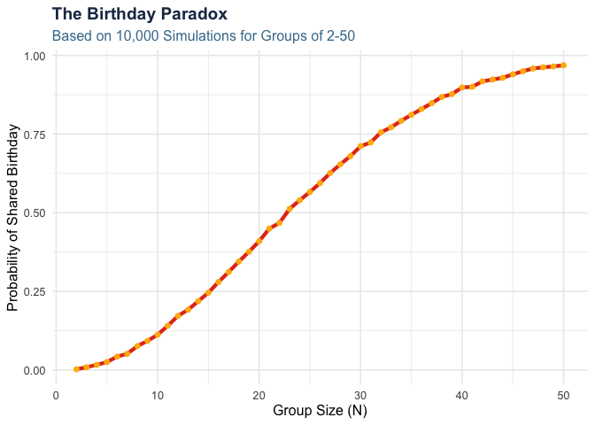
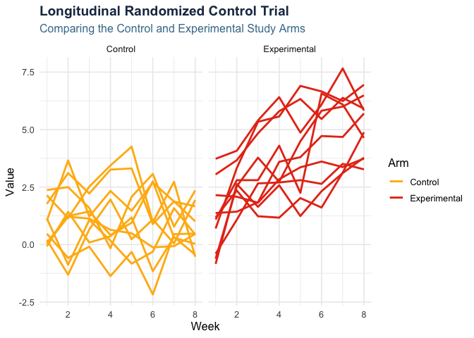
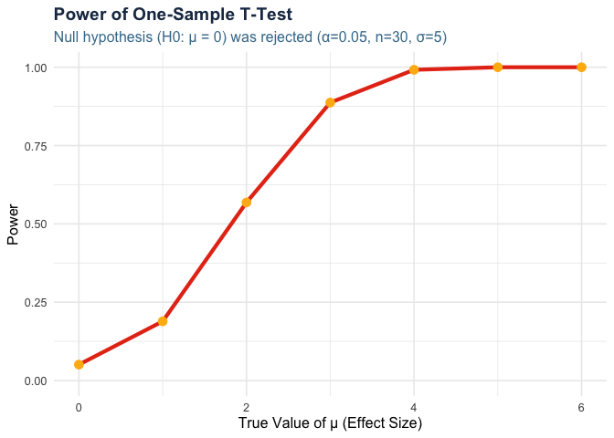
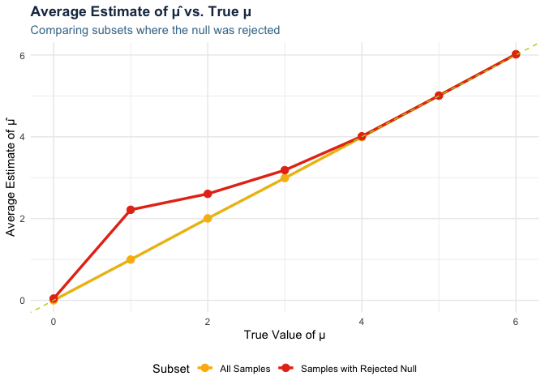

Homework 5
================
Ali Early

## Problem 0

As evidenced throughout this homework.

## Problem 1 - Birthday Paradox Findings

The birthday paradox is the notion that for a randomly selected group of
individuals, there is ~51% chance that at least two people in the group
share the same birthday. Lets find out more about this!

    ## ── Attaching core tidyverse packages ──────────────────────── tidyverse 2.0.0 ──
    ## ✔ dplyr     1.2.1     ✔ readr     2.2.0
    ## ✔ forcats   1.0.1     ✔ stringr   1.6.0
    ## ✔ ggplot2   4.0.3     ✔ tibble    3.3.1
    ## ✔ lubridate 1.9.5     ✔ tidyr     1.3.2
    ## ✔ purrr     1.2.2     
    ## ── Conflicts ────────────────────────────────────────── tidyverse_conflicts() ──
    ## ✖ dplyr::filter() masks stats::filter()
    ## ✖ dplyr::lag()    masks stats::lag()
    ## ℹ Use the conflicted package (<http://conflicted.r-lib.org/>) to force all conflicts to become errors

``` r
# Plot the birthday paradox!
paradox_results_df %>% 
  ggplot(aes(x = n, y = prob)) +
  geom_line(color = "#e63919", linewidth = 1.5) + 
  geom_point(color = "#ffb711", size = 1.7) +       
  labs(
    title = "The Birthday Paradox",
    subtitle = "Based on 10,000 Simulations for Groups of 2-50",
    x = "Group Size (N)",
    y = "Probability of Shared Birthday"
  ) +
  theme_minimal(base_size = 12) +
  theme(
    plot.title = element_text(face = "bold", color = "#1d3551"),
    plot.subtitle = element_text(color = "#457b9a")
  )
```

<!-- -->

#### Figure 1 - Interpretation

Guided by the Birthday Paradox, this figure highlights that as the size
of a group increases, the probability of at least two individuals
sharing a birthday increases (not linear manner). This aligns with our
understanding because the number of possible pairs of individuals grows
quickly rather than linearly with group size.

## Problem 2 - RCT Longitudinal Data

``` r
# Plot the results 
tidy_df %>% 
  ggplot(aes
         (x = week, y = observation, group = interaction(arm, subject_id), color = arm)) +
  geom_path(alpha = 1, linewidth = 1) +
  facet_wrap(~arm) +
  scale_color_manual(values = c("Control" = "#ffb711", "Experimental" = "#e63919")) +
  labs(
    title = "Longitudinal Randomized Control Trial",
    subtitle = "Comparing the Control and Experimental Study Arms",
    x = "Week",
    y = "Value",
    color = "Arm"
  ) +
  theme_minimal(base_size = 12) +
  theme(
    plot.title = element_text(face = "bold", color = "#1d3551"),
    plot.subtitle = element_text(color = "#457b9a"),
    legend.position = "right"
  )
```

<!-- -->

#### Figure 2 - Interpretation

Based on this spaghetti plot, participants in the control arm of the RCT
maintained relatively stable/similar over time. In contrast,
participants in the experimental arm exhibited a general upward trend in
values over time, with the divergence becoming especially pronounced
around the 2- to 4-week mark of the study.

## Problem 3 - T-Test

### Problem 3.1 - Power vs. Effect Size Figure

``` r
power_df = sim_power_df %>% 
  group_by(true_mu) %>% 
  summarize(power = mean(p_value < 0.05))

power_df %>% 
  ggplot(aes(x = true_mu, y = power)) +
  geom_line(color = "#e63919", linewidth = 1.5) +
  geom_point(color = "#ffb711", size = 3) +
  labs(
    title = "Power of One-Sample T-Test",
    subtitle = 
      "Null hypothesis (H0: μ = 0) was rejected (α=0.05, n=30, σ=5)",
    x = "True Value of μ (Effect Size)",
    y = "Power"
  ) +
  ylim(0, 1) +
  theme_minimal(base_size = 12) +
  theme(
    plot.title = element_text(face = "bold", color = "#1d3551"),
    plot.subtitle = element_text(color = "#457b9a")
  )
```

<!-- -->

#### Figure 3.1 - Interpretation

As the true value of μ increases, the power of the test also increases,
reflecting a higher probability of rejecting the false null hypothesis.
The power curve increases as the effect size increases, eventually
leveling off ~1.0 (100% power) once the true value reaches approximately
4.

### Problem 3.2 - Average Estimate of μ Hat Figure

``` r
# Prepare df for data viz
estimate_df = sim_power_df %>% 
  group_by(true_mu) %>% 
  summarize(
    avg_mu_hat_all = mean(mu_hat),
    avg_mu_hat_rejected = mean(mu_hat[p_value < 0.05])
  ) %>% 
  pivot_longer(
    cols = starts_with("avg_mu_hat"),
    names_to = "subset",
    values_to = "mean_estimate"
  ) %>% 
  mutate(
    subset = if_else(subset == "avg_mu_hat_all", "All Samples", "Samples with Rejected Null")
  )

# Plot results
estimate_df %>% 
  ggplot(aes(x = true_mu, y = mean_estimate, color = subset)) +
  geom_line(linewidth = 1.2) +
  geom_point(size = 3) +
  geom_abline(intercept = 0, slope = 1, linetype = "dashed", color = "#afd711") +
  scale_color_manual(values = c("All Samples" = "#ffb711", "Samples with Rejected Null" = "#e63919")) +
  labs(
    title = "Average Estimate of μ̂ vs. True μ",
    subtitle = "Comparing subsets where the null was rejected",
    x = "True Value of μ",
    y = "Average Estimate of μ̂",
    color = "Subset"
  ) +
  theme_minimal(base_size = 11) +
  theme(
    plot.title = element_text(face = "bold", color = "#1d3551"),
    plot.subtitle = element_text(color = "#457b9a"),
    legend.position = "bottom"
  )
```

<!-- -->

#### Figure 3.2 - Interpretation

Across the samples, the average estimate of μ hat generally follows the
true value of μ. This shows that the sample mean estimator is unbiased.
However, when restricting the analysis to samples where the null
hypothesis was rejected, the average estimate of μ hat is overestimated
relative to the true value when the effect size is small. As the true
value increases, power approaches 1.0, causing the lines to converge.

## Problem 3.3 - Write Up

**Question 1:** As the true value of μ increases (larger effect size),
the power of the one-sample t-test increases. When the true effect size
equals 0 (null hypothesis is true), the rejection rate is at the typical
significance level in public health literature (α=0.05). The t-test
becomes better at rejecting the false null hypothesis, eventually ~100%
power at μ≥4.

**Question 2:** Across samples, the average estimate of μ hat is ~ equal
to the true value of μ, confirming that the sample mean is an unbiased
estimator. For the subset of samples where the null hypothesis is
rejected, the average estimate of μ hat is overestimated when the true
effect size is small.This discrepancy is often due to selection bias.
When power is low, a t-test only achieves statistical significance by
chance if random sampling error. As the true effect size increases and
power approaches ~1.0, nearly all samples are able to reject the null,
eliminating this conditional bias and causing the lines to converge on
the plots.
